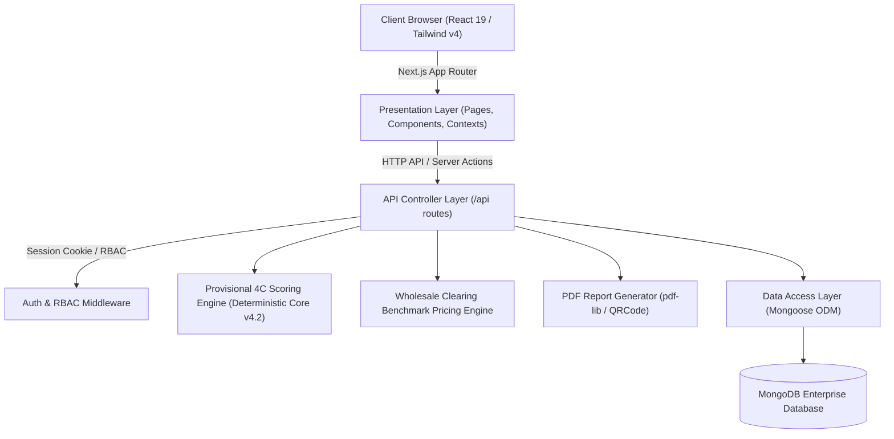

# Open 4Cs System Architecture & Engineering Specification

**Document Version:** 2.0.0  
**Effective Date:** 2026-11-13  
**System:** Open 4Cs — Gemstone Evaluation and Price Suggestion System  
**Pattern:** Next.js App Router Monorepo, Layered Hexagonal/Service Architecture  

---

## 1. High-Level Architecture Overview

---

## 2. Layer Responsibilities & Isolation

### 2.1 Presentation Layer (`src/app/`, `src/components/`, `src/context/`)
- **React 19 Server & Client Components:** Modular component hierarchy separating stateful wizard forms from pure layout views.
- **`EvaluationDraftContext.tsx`:** Manages client-side multi-step wizard state, coordinates live scoring recalculations, and delegates atomic persistence upon final review.
- **`LiveScoreSidebar.tsx`:** Renders live, reactive evaluation scores and deduction checklists directly using the core scoring logic on every wizard step.

### 2.2 Core Scoring Engine Layer (`src/lib/evaluation/`)
- Pure TypeScript, zero-dependency mathematical and gemmological evaluation modules:
  - `evaluateColor.ts`: Evaluates Hue, Tone, Saturation, Distribution, and Zoning.
  - `evaluateClarity.ts`: Evaluates Naked-Eye visibility, 10x Loupe inclusions, and severity.
  - `evaluateCut.ts`: Evaluates proportions, symmetry, polish, windowing, extinction, and bulging.
  - `evaluateCarat.ts`: Evaluates weight tier rarity and physical proportion consistency.
  - `evaluateGemstone.ts`: Coordinates 4C factor aggregation via weighted composite formula.
  - `rules.ts`: Defines immutable production constants (`FOUR_C_WEIGHTS`, `COLOR_FACTOR_WEIGHTS`, etc.).

### 2.3 Wholesale Pricing & Currency Engine (`src/lib/currency/`, `src/lib/evaluation/`)
- `priceSuggestion.ts`: Implements similarity matching and data sufficiency checks ($\ge 3$ verified records).
- `comparablePrice.ts`: Calculates relative adjustment factors to eliminate double-counting.
- `exchangeRate.ts`: Queries dated CBSL indicative exchange rates; enforces LKR-only fallback.

### 2.4 PDF Generation Engine (`src/lib/report/`)
- `generateEvaluationPdf.ts`: Low-level PDF composition using `pdf-lib`. Enforces exact 2-page A4 geometry, embedded vector branding, dynamic photographic evidence, decodable QR codes, and SSRF filtering.

### 2.5 Data Access Layer (`src/models/`, `src/lib/mongodb.ts`)
- Mongoose schemas with explicit indexing, field projections (`select: false` for password hashes), and atomic specimen binding.
