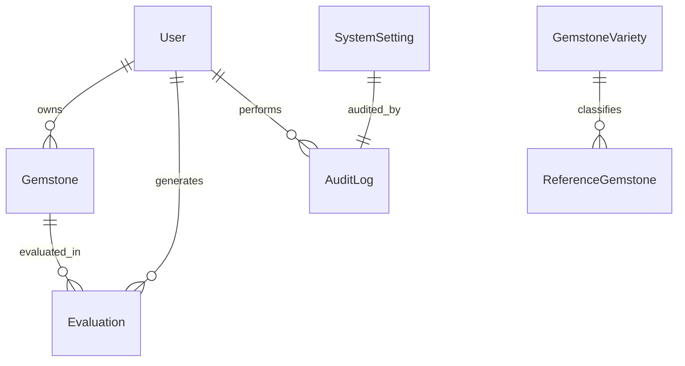

# Open 4Cs Database Schema & Data Models Specification

**Document Version:** 2.0.0  
**Database Engine:** MongoDB 7.0+ via Mongoose ODM  
**Target Database:** `gemstone_evaluation` (Production) / `gemstone_evaluation_test` (Test Suite)  

---

## 1. Entity-Relationship Model

---

## 2. Model Specifications

### 2.1 User Model (`src/models/User.ts`)
| Field | Type | Attributes | Description |
|:---|:---|:---|:---|
| `_id` | ObjectId | Auto-generated PK | Unique user identifier |
| `name` | String | required, trim | Full legal / trade name |
| `email` | String | required, unique, lowercase, index | Login email address |
| `passwordHash` | String | required, **`select: false`** | BCrypt password hash (10 salt rounds) |
| `category` | String | default: "General Enthusiast" | Trade category (e.g. Student, Gemologist, Trader) |
| `role` | String | enum: `["USER", "CAGS_ADMIN"]`, default: `"USER"`, index | RBAC authorization role |
| `status` | String | enum: `["ACTIVE", "SUSPENDED"]`, default: `"ACTIVE"`, index | Account status |
| `isActive` | Boolean | default: true | Activity flag |
| `createdAt` | Date | timestamps: true | Account creation timestamp |
| `updatedAt` | Date | timestamps: true | Account update timestamp |

### 2.2 Gemstone Model (`src/models/Gemstone.ts`)
| Field | Type | Attributes | Description |
|:---|:---|:---|:---|
| `_id` | ObjectId | Auto-generated PK | Unique specimen identifier |
| `userId` | ObjectId | ref: "User", required, index | Specimen owner reference |
| `variety` | String | required, index | Variety name (e.g. Blue Sapphire) |
| `caratWeight` | Number | required | Specimen weight in carats |
| `color` | Object | required | Hue, tone, saturation, distribution, zoning |
| `clarity` | Object | required | Naked-eye, 10x loupe, inclusion type, severity |
| `cut` | Object | required | Length, width, depth, symmetry, polish, windowing |
| `treatment` | Object | default: {} | Treatment status (Untreated, Heated, Unknown) |
| `origin` | Object | default: {} | Provenance value and reliability rating |
| `photoUrl` | String | default: "" | Specimen photograph URL |
| `naturalStatus` | String | default: "Natural" | Natural vs Synthetic indicator |
| Compound Index | `{ userId: 1, createdAt: -1 }` | Fast user gemstone lookup |

### 2.3 Evaluation Model (`src/models/Evaluation.ts`)
| Field | Type | Attributes | Description |
|:---|:---|:---|:---|
| `_id` | ObjectId | Auto-generated PK | Unique evaluation record identifier |
| `userId` | ObjectId | ref: "User", index | Evaluation owner reference |
| `gemstoneId` | ObjectId | ref: "Gemstone", required, index | Evaluated specimen reference |
| `ruleVersion` | String | required | Scoring rule version identifier |
| `status` | String | required | Evaluation status (COMPLETED, PENDING) |
| `result` | Mixed | required | Full 4C evaluation scores and factor breakdown |
| `referenceDataSufficiency` | Mixed | default: null | Status, available and required reference counts |
| `bestReferenceMatch` | Mixed | default: null | Highest similarity reference comparison |
| `priceSuggestion` | Mixed | default: null | Wholesale price calculation and currency details |
| `exchangeRate` | Mixed | default: null | Dated FX rate snapshot |
| `photoUrl` | String | default: "" | Snapshot of specimen photograph URL |
| **`assessmentSnapshot`** | Mixed | default: null | **Immutable point-in-time assessment record** |
| Compound Index | `{ userId: 1, createdAt: -1 }` | Fast user evaluation listing |

### 2.4 ReferenceGemstone Model (`src/models/ReferenceGemstone.ts`)
| Field | Type | Attributes | Description |
|:---|:---|:---|:---|
| `referenceId` | String | required, unique, uppercase, index | Reference lot ID (e.g. REF-1207) |
| `variety` | String | required, index | Corundum variety |
| `caratWeight` | Number | required | Reference carat weight |
| `color` | Object | required | Color characteristics |
| `clarity` | Object | required | Clarity characteristics |
| `cut` | Object | required | Proportions and finish |
| `referencePrice` | Number | required | Benchmark transaction price |
| `currency` | String | default: "LKR" | Benchmark currency |
| `verificationStatus` | String | enum: `["Pending", "Verified", "Rejected"]`, default: `"Pending"`, index | Independent verification status |
| `dataClassification` | String | enum: `["Real", "Demo"]`, default: `"Demo"`, index | Commercial vs Demo flag |
| `transactionContext` | String | default: "Dealer Estimate" | Context (Completed Sale vs Estimate) |
| `marketContext` | String | default: "Wholesale" | Market tier |
| `observationDate` | String | required | Transaction date |
| `sourceEvidence` | String | default: "" | Traceable evidence notes |

### 2.5 SystemSetting Model (`src/models/SystemSetting.ts`)
| Field | Type | Attributes | Description |
|:---|:---|:---|:---|
| `key` | String | required, unique, index | Settings key (`default_cags_governance`) |
| `orgName` | String | required | Governing organization name |
| `adminEmail` | String | required | System administrator email |
| `baseCurrency` | String | default: "LKR — Sri Lankan Rupee" | Primary regional currency |
| `activeRuleset` | String | default: "v4.2" | Active deterministic rule version |
| `updatedBy` | String | default: "System Admin" | User who last changed settings |

### 2.6 AuditLog Model (`src/models/AuditLog.ts`)
| Field | Type | Attributes | Description |
|:---|:---|:---|:---|
| `action` | String | required, index | Action name (e.g. USER_STATUS_CHANGED, SETTINGS_UPDATED) |
| `performedBy` | Object | required | User ID, name, email |
| `targetType` | String | enum: `["ReferenceGemstone", "GemstoneVariety", "EvaluationRule", "User", "System"]` | Target entity collection |
| `targetId` | String | default: "" | Target entity identifier |
| `summary` | String | required | Human-readable log summary |
| `details` | Mixed | default: {} | Before/after mutation payload |
